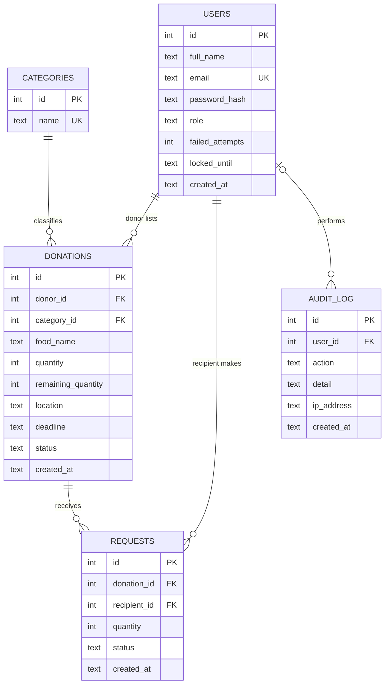

# SmartSurplus – DBMS Practical: Database Integration Guide

> **Audience:** the student and any AI coding agents (e.g. Antigravity) helping them.
> **Goal:** show the instructor tomorrow a Flask web app that is *really* connected to a relational database, and demonstrate DBMS concepts live with SQL.
> **Decision already made:** use **SQLite**. It ships with Python, needs no server, no install, no account, no internet. Azure SQL support exists in the code as an optional bonus – **do not touch it unless the student asks**.

---
## 1. Current state (already implemented – do NOT rewrite)

| Item | File | What it does |
|---|---|---|
| DB connection layer | `db.py` | Opens `instance/smartsurplus_v2.db` (SQLite) by default; uses Azure SQL only if env var `AZURE_SQL_CONNECTION_STRING` is set |
| Schema (DDL) | `sql/schema_sqlite.sql` | 5 tables, constraints, 4 indexes, 1 view, seed categories. Auto-run when the app starts |
| App + SQL queries | `app.py` | Routes: register, login, donate, donations (search), claim (transaction), my activity, admin audit |
| Demo data | `seed_demo.py` | Inserts 5 users, 4 donations, 3 requests |
| Practical queries | `sql/demo_queries.sql` | ~30 ready-made queries in viva order (DDL, DML, constraints, joins, aggregates, subqueries, view, index, transaction) |
| Viva Q&A | `docs/VIVA_GUIDE.md` | Concepts + model answers |

The database file is created automatically on first run. Nothing else needs linking.

### Database design (ER diagram)

Relationships: users 1—N donations; categories 1—N donations; donations 1—N requests; users 1—N requests (so donations ↔ recipients is **many-to-many through `requests`**); users 0..1—N audit_log.

---
## 2. Setup – step by step (≈5 minutes)

Run from the project root (the folder containing `app.py`).

```bash
# 1. virtual environment
python -m venv .venv
# Windows:  .venv\Scripts\activate        macOS/Linux:  source .venv/bin/activate

# 2. install ONLY what is needed for SQLite
pip install Flask python-dotenv
#   (requirements.txt also lists pyodbc for the optional Azure mode; it is NOT needed for the practical.
#    If `pip install -r requirements.txt` fails on pyodbc, ignore it and use the line above.)

# 3. load demo data (creates instance/smartsurplus_v2.db automatically)
python seed_demo.py

# 4. run the app
python app.py          # open http://127.0.0.1:5000
```

**Demo logins** (password for all: `Demo@1234`)

| Email | Role |
|---|---|
| donor1@demo.com, donor2@demo.com | donor |
| ngo1@demo.com, ngo2@demo.com | recipient |
| admin@demo.com | admin (can open `/admin/audit`) |

**Reset everything:** stop the app, delete the `instance/` folder, run `python seed_demo.py` again.

> `python` may be `python3` / `py` on your machine.

---
## 3. How to show the database to the instructor

Pick ONE viewer (all free, 2-minute install):

1. **DB Browser for SQLite** (recommended, GUI): File → Open Database → `instance/smartsurplus_v2.db`. Tabs: *Database Structure*, *Browse Data*, *Execute SQL* (paste from `sql/demo_queries.sql`).
2. **VS Code extension "SQLite Viewer"** – click the `.db` file.
3. **Command line:** `sqlite3 instance/smartsurplus_v2.db` then `.tables`, `.schema donations`, `.headers on`, `.mode column`, then paste queries. (If `sqlite3` is missing: `python -m sqlite3 instance/smartsurplus_v2.db`, Python 3.12+.)

Tip: keep the browser (app) on one half of the screen and the DB viewer on the other so the instructor sees **a form submission appear as a row** (press *Refresh* / *Browse Data*).

---
## 4. Live demo script (≈7 minutes)

1. **Schema** – open DB viewer → Database Structure: 5 tables, 1 view, 4 indexes. Say: "3NF, PK/FK, CHECK, UNIQUE constraints."
2. **App → DB insert** – log in `donor1@demo.com` → *Donate* → add "Rotis", category, qty 20 → then in viewer run `SELECT * FROM donations ORDER BY id DESC;` – new row appears.
3. **App → DB update in a transaction** – log in `ngo1@demo.com` → *Donations* → reserve 5 portions of Rotis → viewer: `SELECT id, remaining_quantity FROM donations;` (20 → 15) and `SELECT * FROM requests ORDER BY id DESC;` (new row).
4. **Integrity** – try reserving more than remain → error message; show section 4 of `demo_queries.sql` (constraint violations).
5. **Queries** – run joins, GROUP BY/HAVING, subquery, view from `demo_queries.sql` (sections 5–8).
6. **Index** – run `EXPLAIN QUERY PLAN …` (section 9) → shows `USING INDEX ix_donations_status_deadline`.
7. **Transaction** – run section 10: change → ROLLBACK → value restored (Atomicity).
8. **Security touch** – search `' OR 1=1 --` on the Donations page: returns nothing (parameterised queries). Show `password_hash` column is a hash, not plain text.

---
## 5. Where each DBMS concept lives (for viva)

| Concept | Show this |
|---|---|
| DDL (CREATE) | `sql/schema_sqlite.sql` |
| DML (INSERT/UPDATE/DELETE/SELECT) | `app.py` + `sql/demo_queries.sql` §2–3 |
| Constraints (PK, FK, UNIQUE, CHECK, NOT NULL, DEFAULT) | schema file + `demo_queries.sql` §4 |
| Normalization (up to 3NF) | `categories` split out of `donations`; donor data only in `users` |
| Joins (inner, left) | `demo_queries.sql` §5; `my_activity()` in `app.py` |
| Aggregates, GROUP BY, HAVING | §6 |
| Subqueries (scalar, IN, NOT EXISTS) | §7 |
| View | `v_open_donations` (§8) |
| Index | `ix_donations_status_deadline` (§9) |
| Transaction, ACID, rollback | `claim()` in `app.py` (3 statements, one commit) + §10 |
| Concurrency | conditional `UPDATE … WHERE remaining_quantity >= ?` – atomic, prevents overselling |
| SQL injection defence | `?` placeholders in every query in `app.py`/`db.py` |
| Many-to-many | `requests` is the associative table |

More Q&A: `docs/VIVA_GUIDE.md` §2.

---
## 6. Instructions for AI agents

**Do**
- Keep SQLite as the default. Run steps in §2 and the checks in §7; report results.
- If something fails, fix the *minimum* needed and explain what and why.
- If asked to add features, keep every query parameterised (`?`) and go through `db.py` helpers (`query`, `query_one`, `execute`, `insert`, `commit`, `rollback`).
- Any new table → add it to **both** `sql/schema_sqlite.sql` and `sql/schema_sqlserver.sql`.

**Do not**
- Do not switch to MySQL/PostgreSQL/ORMs (SQLAlchemy) – it adds setup risk the night before the practical.
- Do not build SQL by string concatenation or f-strings with user input.
- Do not delete `sql/`, `db.py`, `seed_demo.py`.
- Do not require internet, Azure, or ODBC for the practical.
- Do not rename the DB file (`instance/smartsurplus_v2.db`) – docs and viewers point to it.

**Known gotchas**
- `pip install -r requirements.txt` can fail on `pyodbc` without ODBC libs → install `Flask python-dotenv` only.
- Run `python app.py` from the project root, or `instance/` ends up in a different folder.
- If the DB viewer shows locked/old data, close and reopen it (SQLite file is held while a write dialog is open).
- Existing old `instance/smartsurplus.db` (from the first version) is unused; ignore or delete.
- Forms need cookies enabled (CSRF token); testing with curl needs the token.

---
## 7. Verification checklist (agents: run and tick before finishing)

- [ ] `python seed_demo.py` prints "Demo data inserted" (re-run prints "already present").
- [ ] `python app.py` starts with no traceback; `/` returns the homepage.
- [ ] Log in as `donor1@demo.com`; `/donate` works; submitting creates a row in `donations`.
- [ ] Log in as `ngo1@demo.com`; reserving portions decreases `remaining_quantity` and inserts into `requests`.
- [ ] Reserving more than available shows an error and changes nothing.
- [ ] `sql/demo_queries.sql` §1–3, 5–10 run without error; §4 and §11 statements fail with CHECK/UNIQUE/FOREIGN KEY errors (that is intended).
- [ ] Log in as `admin@demo.com`; `/admin/audit` lists events.
- [ ] Quick DB check: `SELECT COUNT(*) FROM users;` → 5 (after fresh seed).

---
## 8. Optional bonus (only if time remains and the student asks)

**Azure SQL:** create a free Azure SQL Database, install ODBC Driver 18, copy `.env.example` to `.env`, fill `AZURE_SQL_CONNECTION_STRING`, run `flask --app app init-azure-db`, then `python app.py`. Same app, same queries; show the data in the portal's Query editor. Details: `docs/VIVA_GUIDE.md` §1.

**If the instructor insists on MySQL:** tell the student; this is a larger change (new driver, `AUTO_INCREMENT`, `?`→`%s` placeholders) and should be planned separately rather than done at the last minute.

---
## 9. Night-before checklist for the student
1. Do §2 once on the laptop you will carry; confirm the app and viewer both work **offline**.
2. Practise the §4 demo script twice (≈7 min).
3. Read `docs/VIVA_GUIDE.md` §2 (DBMS) and be able to draw the ER diagram from memory.
4. Be able to explain, in your own words: why SQLite? (zero-setup, file-based relational engine, supports SQL/ACID/FK/views/indexes); limitation? (single-writer, no user management, not for heavy concurrent load → that's why the project also supports Azure SQL).
5. Back up: copy the whole project folder and `instance/smartsurplus_v2.db` to a USB/cloud drive.
